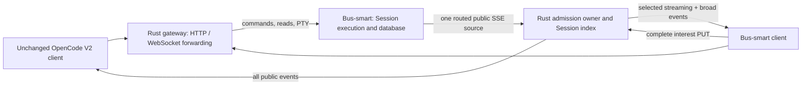

# Rust subscription-aware gateway

## Decision

Build a standalone, same-origin gateway in `opencode-bus-proxy`, with a small
authoritative export added to `opencode-bus-smart`. The earlier
`opencode-bus-smart/design/event-multiplexer` documents are design inputs. This
design deliberately chooses Rust and transparent API forwarding to satisfy the
current request for unchanged client connections.

Both clients configure the proxy as their ordinary server URL. Direct bus-smart
connections continue to use its existing endpoints. An unchanged V2 client
provides no Session-interest declaration: it gets broadcast delivery, with
fan-out costs paid by the proxy. A bus-smart client negotiates the existing
`session-streaming` profile and supplies exact Session interests. Directory
headers, API reads, or arbitrary `data.sessionID` fields are not subscriptions.

## Source authority and delivery

[The source contract](source-contract.md) defines a versioned SSE export. Origin
classifies a public event once and copies Bus's authoritative Session identity.
The proxy decodes only that envelope, retaining the public event as raw JSON. It
constructs one shared `Bytes` SSE frame, cloned by reference into selected queues.
No per-client JSON serialization or full native-event schema is needed in Rust.

The existing five streaming types are Session-selective. RPC events, durable
Session events, permissions, forms, and other public events remain broad. A
Session-routed event without authoritative identity reaches only legacy clients.
Routing stays with the origin so new payload shapes do not require speculative
Rust payload inspection. Version changes must explicitly negotiate new semantics.

There is one eager source connection and one reconnect owner per daemon. This
changes origin fan-out from client-count queue admissions to one export admission.
It still costs origin serialization and a socket; an unobserved event may now be
encoded where embedded filtering would skip it. Measure execution-process latency
separately from total CPU. Upstream union-of-interest filtering can be evaluated
after the basic topology is measured; it adds synchronization obligations.

## Crate boundaries

| Crate | Responsibility |
| --- | --- |
| `bus-proxy-protocol` | Source envelopes, incremental bounded SSE decoding, existing interest validation, ready/connected/error JSON framing |
| `bus-proxy-router` | Subscription lifetime, indexed admission, complete replacement, bounded queues, epoch invalidation, inspectable state/counters |
| `bus-proxy-gateway` | Upstream connection/retry, authentication integration, SSE endpoints, streaming HTTP and WebSocket proxying, health/metrics |
| `opencode-bus-proxy` | CLI configuration, tracing subscriber, signal/shutdown composition |

Protocol has no network/runtime requirement. Router depends on protocol and Tokio,
not HTTP. Gateway composes protocol/router with Hyper. Daemon is a thin host.

## Concurrency and bounds

Use one admission owner for Session membership and client state. Complete
replacement and event admission are serialized at that owner; no concurrent-map
snapshot can outlive an interest change. Fast hash lookup maps Session IDs to
subscriber sets, making selective fan-out `O(followers + legacy clients)` and broad
fan-out `O(active clients)`. A concurrent map such as DashMap does not by itself
make multi-index mutation atomic; choose it only if measurement motivates a
sharded architecture with a precise cut contract.

All downstream offers are nonblocking. Bound queue frame count **and** bytes,
source frame size, interest request bytes/entries, and total subscriptions. A slow
subscriber is invalidated and its queued data discarded; healthy neighbors and
origin execution are not held behind its socket. Subscription disposal removes
all membership entries. Pending controlled streams count toward resource bounds.

The first controlled frame is `event-feed.ready`. Until the first valid interest
PUT there is no domain delivery. Activation queues `server.connected` before any
domain event; subsequent PUTs replace the entire set atomically and return 204.
The acknowledgment describes proxy admission. It does not flush old queued frames
or synchronize origin publication with canonical HTTP reads.

## Failure and lifecycle

Source readiness is required for registration. Source loss invalidates every
dependent subscription and discards buffered old-epoch work. A healthy HTTP
listener is not a ready event source. A reconnect establishes a fresh epoch;
clients reopen streams and install fresh interests through their existing retry
owners. No downstream stream survives a hidden upstream gap.

An epoch is volatile, with no replay cursor or exactly-once claim. Comments are
heartbeats; there is no per-token logging. Invalid source framing or envelope is
a source failure, not an event to silently skip. Normal API traffic remains
forwardable while the event source reconnects.

## Compatibility and authentication

Intercept the existing legacy GET, controlled GET, and interest PUT paths. Reserve
`/_bus/` for proxy diagnostics and refuse downstream access to the internal source
path. Stream other request/response bodies without buffering, preserve status and
end-to-end headers, strip HTTP hop-by-hop headers, and tunnel successful protocol
upgrades so PTYs work. Do not follow redirects on behalf of callers.

The proxy is inside the same trusted server boundary and must protect local feed
and diagnostic routes with the configured server authentication. Upstream service
credentials come from environment/file configuration, never URL arguments or logs.
The exact authentication integration is grounded in the checked-out server, with
explicit limitations documented rather than an accidental unauthenticated bypass.

## Observability and evidence

Use `tracing` spans for source attempts/epochs, HTTP requests, subscription
lifetimes, and interest changes. Redact credentials, query strings, and bodies;
avoid per-recipient/per-token spans. Expose bounded-label counters/gauges for
source frames/bytes/failures, admissions/bytes, skipped publications, subscribers,
memberships, queue overflows, and current readiness. These are admissions, not
confirmed client receipt. An authenticated subscription inspection endpoint shows
which live IDs are legacy, pending, or following which Sessions; IDs are not
metric labels.

Verification uses selection/identity tests, activation/replacement cuts, byte and
count overflow isolation, disconnect cleanup, epoch reset, incremental SSE
framing, real HTTP/proxy/upgrade integration, and origin public-only export tests.
A release-mode fan-out benchmark covers broad, disjoint, and no-follower workloads
and reports measured throughput, not a claim of end-to-end deployment gains.

Implementation proceeds through committed source contract and research, independent
origin/protocol/router/gateway builds, integration and review corrections, then
operating documentation and recorded verification. Tests use isolated listeners;
the running OpenCode service is not a test fixture.
